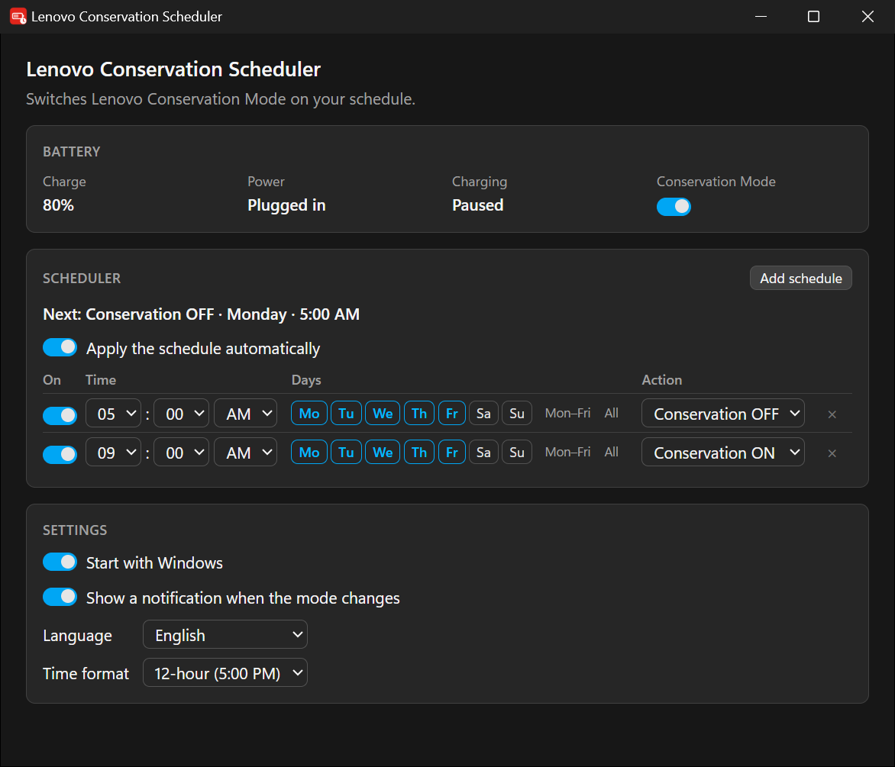
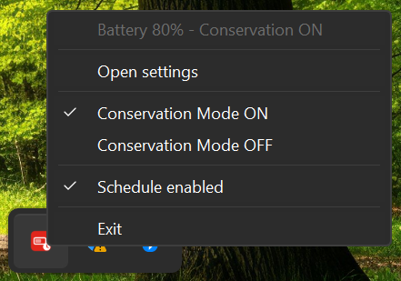

# Lenovo Conservation Scheduler


[](https://github.com/fajarwz/lenovo-conservation-scheduler/releases/latest) [](https://github.com/fajarwz/lenovo-conservation-scheduler/releases) [](LICENSE)

A small Windows tray utility that switches Lenovo battery **Conservation Mode** on a schedule.

**Download: [installer](https://github.com/fajarwz/lenovo-conservation-scheduler/releases/latest/download/Lenovo-Conservation-Scheduler-setup.exe) or [portable exe](https://github.com/fajarwz/lenovo-conservation-scheduler/releases/latest/download/Lenovo-Conservation-Scheduler-portable.exe)** - always the newest release. Windows 10/11 on a Lenovo laptop, no administrator rights.



The case it exists for: keep Conservation Mode on at home so the battery sits around 75-80%, and have it switch off early enough to reach 100% before you leave.

```
05:00  ->  Conservation Mode OFF   (Monday to Friday)
09:00  ->  Conservation Mode ON    (Monday to Friday)
```

> Not affiliated with Lenovo. It drives Lenovo's own software in place and bundles nothing from Lenovo.

## How it works

- **Lenovo control** goes through Vantage's own `PowerBattery.dll`, loaded in place from
  `C:\ProgramData\Lenovo\Vantage\Addins\IdeaNotebookAddin\<version>\`. Nothing is bundled or
  redistributed; if the DLL is missing the app says so and keeps running with manual switching
  disabled.
- **No polling.** One thread, blocked on a waitable timer for the next occurrence plus Windows events
  for "settings edited" and "resumed from sleep". Zero CPU while idle.
- **Reconcile, never replay.** On every wake it asks what the schedule expects *now* and writes only
  if the mode differs - which is why a laptop that slept through 05:00 corrects itself at 07:30.
- **Manual changes win** until the next scheduled occurrence.
- **The tray menu** opens the settings, switches the mode by hand, and exits. Left-click opens the
  window, right-click shows the menu:

  
- **One copy at a time**, one tray icon. Launching it again just shows the running window.
- **Notifications under its own name and icon**, not PowerShell's, and a toast on a manual launch that
  went straight to the tray.

## Footprint

Measured on the release build (Lenovo Yoga Slim 7 14IMH9, Windows 11), whole process tree included:

| State | Processes | Working set | Private memory | CPU while idle |
| --- | --- | --- | --- | --- |
| Running, settings never opened | 1 | ~15 MB | ~3 MB | 0.000 s over 62 s |
| Settings window open | 7 | ~350 MB | ~180 MB | the browser's, while you look at it |
| After closing the window | 1 | ~23 MB | ~5 MB | 0.000 s |

The ~350 MB belongs to WebView2, Windows' own Chromium engine, and only while the window is open -
which is why the window is created on demand and destroyed on close. Idle the app owns no sockets and
writes nothing.

## Install

| Download | What it is |
| --- | --- |
| [Installer](https://github.com/fajarwz/lenovo-conservation-scheduler/releases/latest/download/Lenovo-Conservation-Scheduler-setup.exe) | Installs per user, needs no administrator rights, and adds the "start with Windows" option. |
| [Portable exe](https://github.com/fajarwz/lenovo-conservation-scheduler/releases/latest/download/Lenovo-Conservation-Scheduler-portable.exe) | Nothing to install and nothing beside it, everything stays in your own profile - but do not move it after the first run, because the "start with Windows" entry records the path it was launched from. |
| [MSI](https://github.com/fajarwz/lenovo-conservation-scheduler/releases/latest/download/Lenovo-Conservation-Scheduler.msi) | For deploying with a policy - Intune, SCCM, Group Policy. The same app as the installer, packaged as an MSI. |

All three go through `/releases/latest/download/`, so they always serve the newest release without this
file needing an edit. [RELEASING.md](RELEASING.md) is the release procedure behind them.

Releases are **unsigned**, so Windows warns on the first run: SmartScreen's "Windows protected your
PC" dialog for any downloaded file. Click **More info** -> **Run anyway**, or unblock the file first
(right-click -> **Properties** -> **Unblock** -> **OK**, or `Unblock-File .\Lenovo-Conservation-Scheduler-setup.exe`).
The release notes carry a SHA-256 for each download.

## Requirements

- Windows 10/11 on a Lenovo laptop that supports Conservation Mode.
- Lenovo Vantage installed (it reads `PowerBattery.dll` from it) and the
  `Lenovo Notebook ITS Service` running.
- No administrator rights: it runs as a normal user process.
- No network access, no telemetry, no database, no backend, no account.

## Settings

Configuration is one JSON file at `%APPDATA%\com.fajarwz.lenovo-conservation-scheduler\config.json`,
which can be edited by hand:

```json
{
  "scheduleEnabled": true,
  "startWithWindows": false,
  "notifyOnChange": true,
  "locale": "en-US",
  "timeFormat": "24h",
  "schedules": [
    {
      "id": "weekday-morning",
      "enabled": true,
      "time": "05:00",
      "days": ["monday", "tuesday", "wednesday", "thursday", "friday"],
      "action": "conservation_off"
    }
  ]
}
```

- `time` is 24-hour local `HH:MM`, `action` is `conservation_on` or `conservation_off`
- `locale` - `en-US` or `id`, the language of the window, tray menu and notifications. Read leniently:
  `en`, `en-GB`, `id-ID` all work.
- `timeFormat` - `24h` or `12h`, how times are written in the window only. The file always stores
  24-hour `HH:MM`.

## Logs

One line per event: the config it loaded, the moment it armed, each wake-up, every mode it changed and
any failure. Nothing is logged while it waits. In a release build it writes to:

```
%LOCALAPPDATA%\com.fajarwz.lenovo-conservation-scheduler\logs\lenovo-conservation-scheduler.log
```

If a switch did not happen, that file says why.

## Development

```bash
npm install
npm run tauri dev      # the app
npm run tauri build    # executable + installers
```

Tests: `cd src-tauri && cargo test -- --test-threads=1` - serial on purpose, one test toggles the real
charging mode. [CONTRIBUTING.md](CONTRIBUTING.md#development) has the full check list.

Build the executable only through the Tauri CLI: a bare `cargo build --release` skips the
`custom-protocol` feature and ships a window that tries to load `http://localhost:1420`.
[AGENTS.md](AGENTS.md) documents the architecture and the rest of the build traps.

## Contributing

Issues and pull requests are welcome - especially reports from Lenovo models other than the one this
was built on. [CONTRIBUTING.md](CONTRIBUTING.md) covers bug reports, translations and what a change has
to keep.

## Security

Report vulnerabilities privately via [GitHub](https://github.com/fajarwz/lenovo-conservation-scheduler/security/advisories/new)
or `hi@fajarwz.com`. [SECURITY.md](SECURITY.md) lists the scope.

## License

MIT - see [LICENSE](LICENSE). Copyright (c) 2026 Fajar Windhu Zulfikar.
